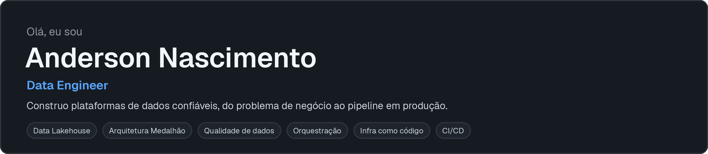
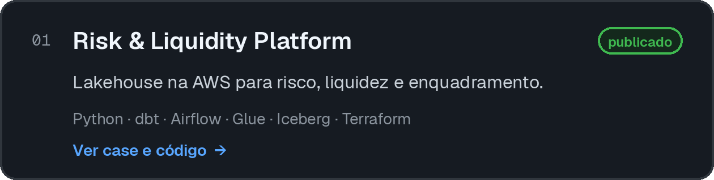
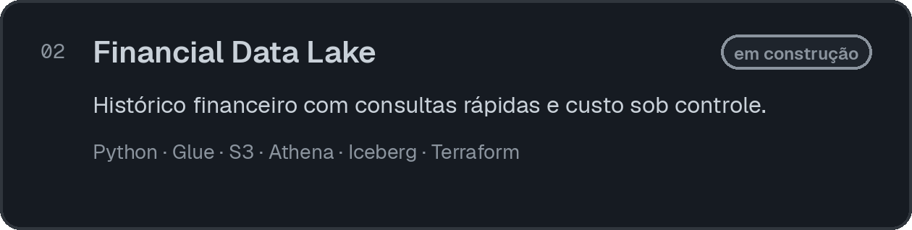
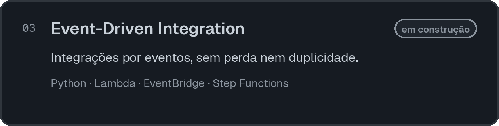

  
  
  

  <a href="https://anderson-adm.github.io/data-engineer-portfolio-site/"><b>Portfólio</b></a> ·
  <a href="https://www.linkedin.com/in/anderson-santos-do-nascimento"><b>LinkedIn</b></a> ·
  <a href="mailto:asnmec@gmail.com"><b>E-mail</b></a>

